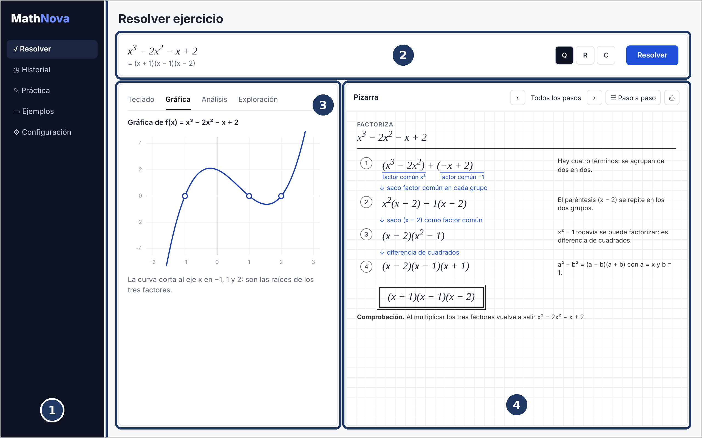
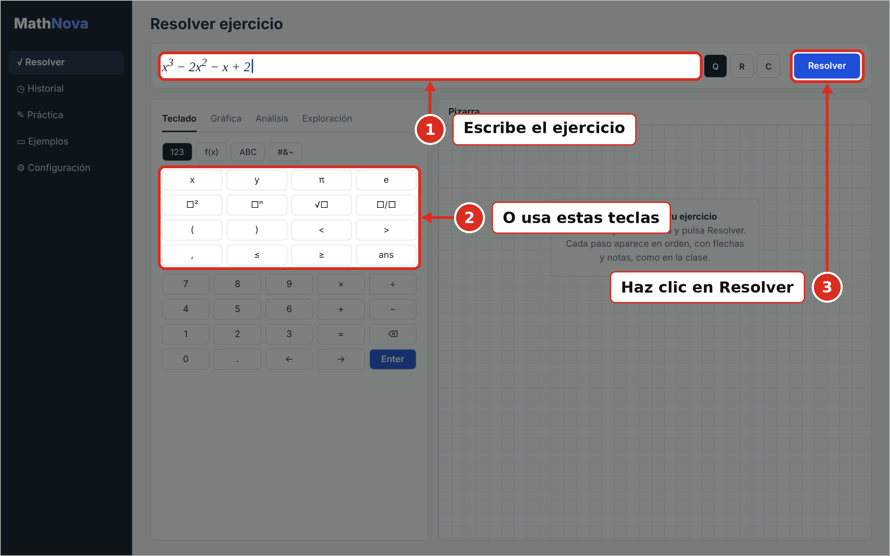
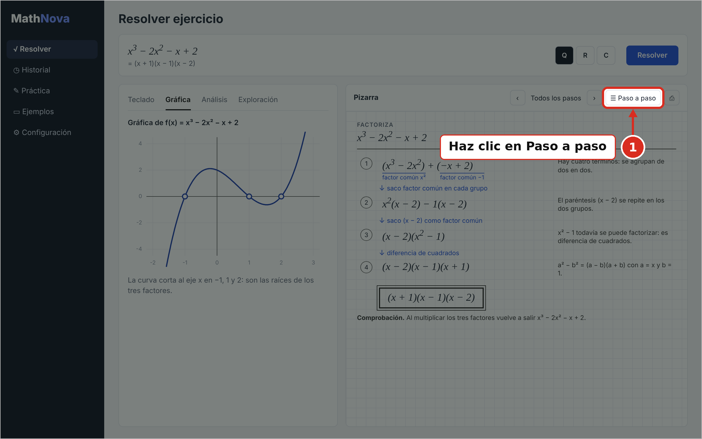
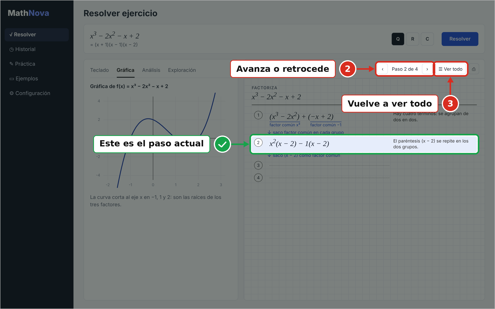
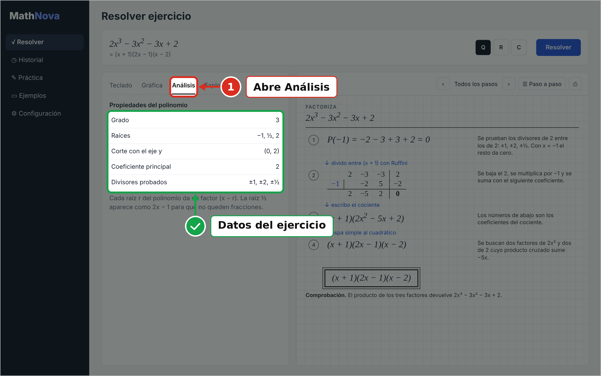

# 1. Introducción

## 1.1 Propósito del manual

Este manual explica cómo usar MathNova para resolver ejercicios y entender cada paso de la solución.

## 1.2 Alcance

Cubre la versión 1.0 de MathNova. Explica cómo escribir y resolver ejercicios, leer la Pizarra y usar las pestañas de apoyo. No enseña matemáticas.

## 1.3 Público al que va dirigido

Estudiantes de secundaria y de los primeros ciclos universitarios. No se necesitan conocimientos de computación.

## 1.4 Convenciones del manual

- **Círculo rojo con número:** paso que debes hacer. Síguelos en orden.
- **Círculo verde con ✓:** lo que verás cuando todo salió bien.
- **Texto en negrita:** nombre exacto de un botón o pestaña.
- **Importante:** algo que debes saber antes de empezar.

## 1.5 Norma de referencia

Este manual sigue la norma ISO/IEC/IEEE 26514:2022, Systems and software engineering — Design and development of information for users.

# 2. Conoce MathNova

La ventana de MathNova tiene cuatro zonas.

1. **Menú:** Resolver, Historial, Práctica, Ejemplos y Configuración.
2. **Barra del ejercicio:** aquí escribes el ejercicio y haces clic en **Resolver**.
3. **Herramientas:** pestañas **Teclado**, **Gráfica**, **Análisis** y **Exploración**.
4. **Pizarra:** la solución, paso a paso, con flechas y notas.

# 3. Cómo escribir un ejercicio

Escribe el ejercicio con tu teclado o con el teclado de MathNova (pestaña **Teclado**).

- Para una potencia usa **^**: x^3
- Para multiplicar usa **\***: 3*x
- Para fracciones y raíces usa las teclas **□/□** y **√□**.

**Importante:** no tienes que decir qué hacer. MathNova reconoce solo el ejercicio.

# 4. Resolver un ejercicio

## 4.1 Escribir y resolver

Ruta: Menú › Resolver

**Ejemplo:** factoriza x³ − 2x² − x + 2.

(x − 1)(x − 2).")

**Si sale "No se reconoce el ejercicio":** revisa cómo lo escribiste (capítulo 3).

## 4.2 Ver la solución paso a paso

Sirve para avanzar paso por paso, como en clase.

# 5. Herramientas de apoyo

Después de resolver, las pestañas de la izquierda te ayudan a entender el ejercicio.

## 5.1 Ver los datos del ejercicio

Ruta: Resolver › pestaña Análisis

**Ejemplo:** resuelve 2x³ − 3x² − 3x + 2 y abre **Análisis**.

